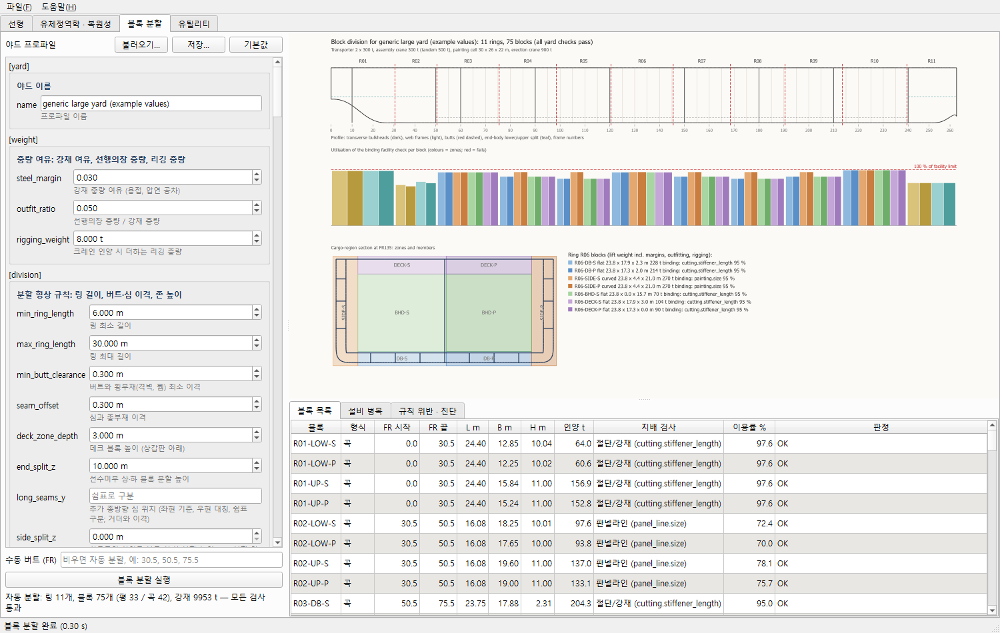
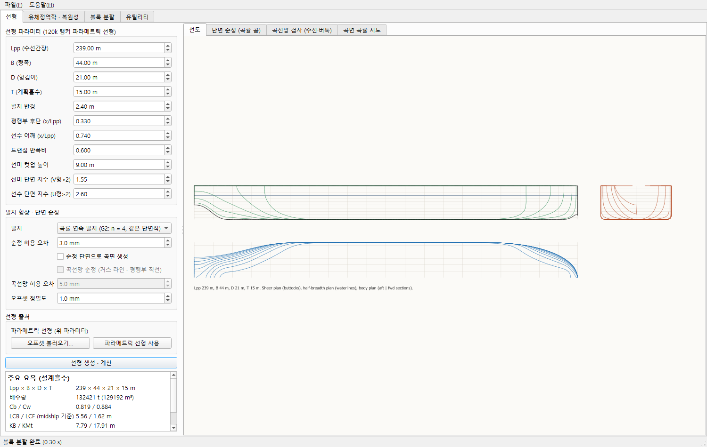
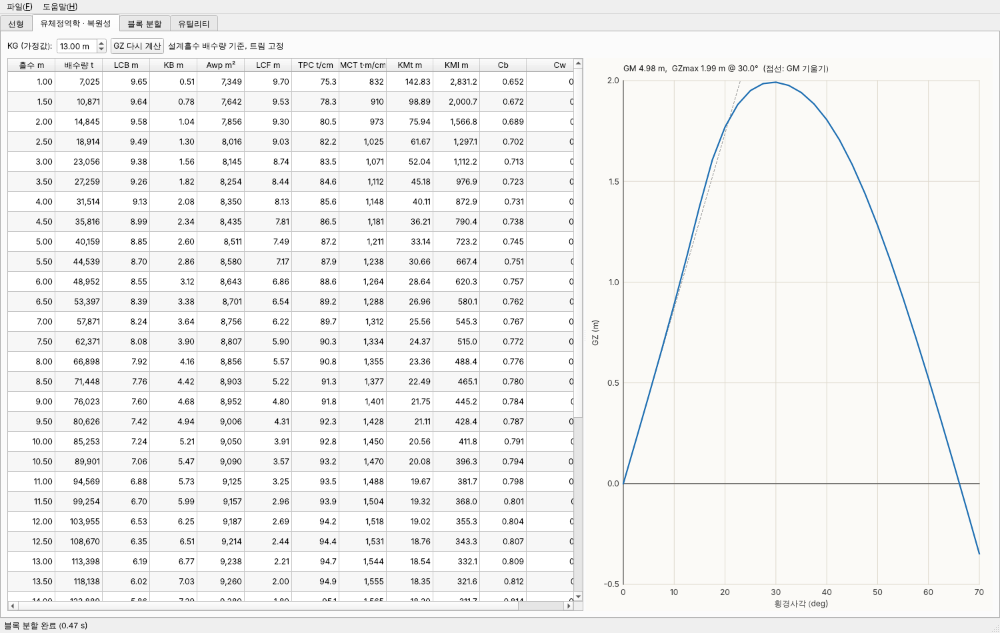
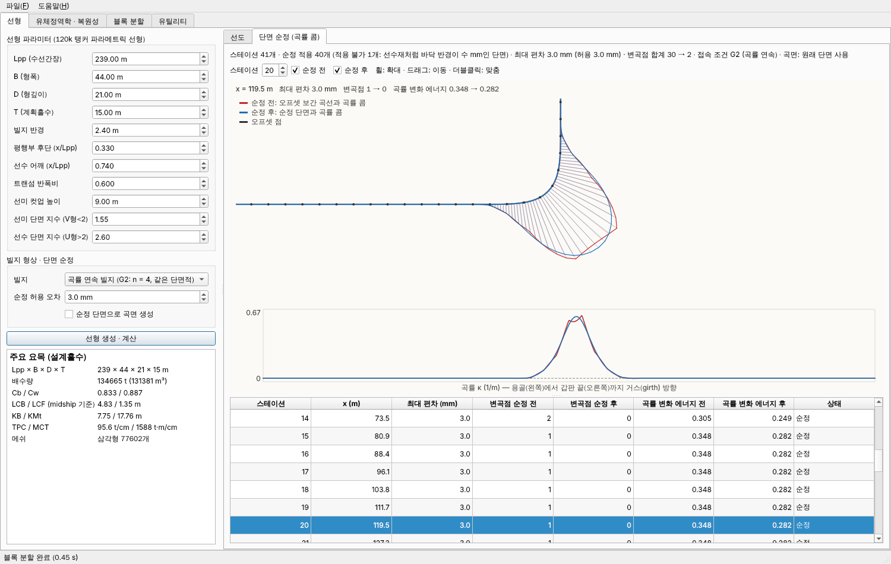
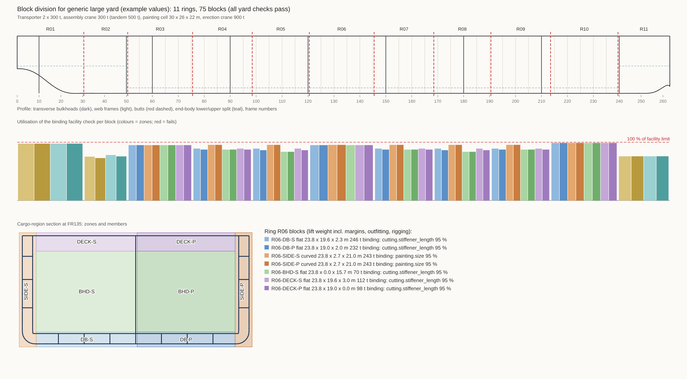
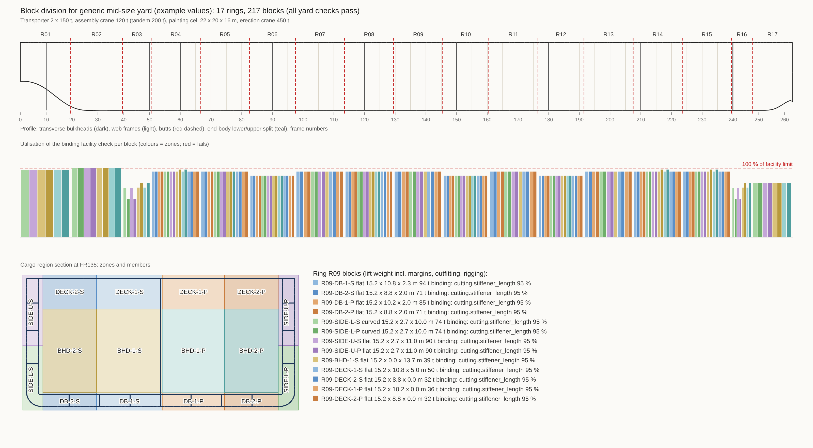
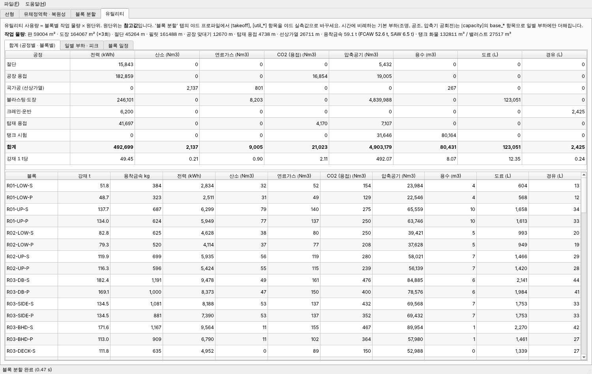
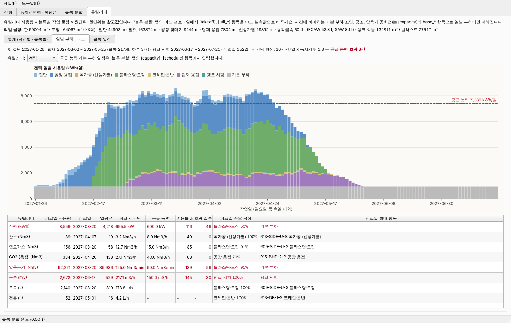

# hullcad: 조선 설계용 선형 CAD

선형(hull form)을 B-spline 곡면으로 정의하고, 유체정역학·복원성과 블록 분할을 계산하는 C++20 프로그램입니다.
계산은 **멀티스레드 CPU**와 **GPGPU(CUDA)** 백엔드로 하고, **Windows x64 / ARM64 데스크톱 앱(Qt 6)**을 제공합니다.
기준선은 **120k DWT 원유 탱커(Aframax/LR2급)**입니다.



## 데스크톱 앱 (Windows x64 / ARM64)

| 탭 | 내용 |
|---|---|
| 선형 | 주요 치수와 형상 파라미터를 입력하면 선형을 생성합니다. 주요 요목을 계산하고 선도를 보여 줍니다(휠 확대, 드래그 이동, 더블클릭 맞춤). **단면 순정** 하위 탭에서 순정 전후 곡률 콤과 스테이션별 품질을 봅니다. |
| 유체정역학 · 복원성 | 정수압 곡선표, KG를 입력해 GZ 곡선 계산 |
| 블록 분할 | **야드 프로파일 입력 화면**. 옵션 변수를 공정별로 묶은 폼입니다. 블록 분할도, 블록 목록(정렬), 설비 병목, 규칙 위반·진단을 보여 줍니다. |
| 유틸리티 | 공정별·블록별 전력, 산소, 연료가스, CO₂, 압축공기, 용수, 도료, 경유 사용량과 작업 물량. 강재 1 t당 원단위. **일별 부하 차트(공정별 누적, 공급 능력선), 피크·용량 검토, 블록 일정** |

- 입력 폼은 옵션 등록부(`yard_options()`, project 모듈)에서 **자동 생성**됩니다. 코드에 옵션을 추가하면 화면에도 바로 나타납니다.
- 공정을 끄면 그 공정의 한계값 입력이 비활성화됩니다.
- 계산은 백그라운드 스레드에서 돌아가므로 화면이 멈추지 않습니다.
- 파일 메뉴에서 야드 프로파일 열기·저장, 블록 CSV, 도면 SVG, 메쉬 OBJ를 내보낼 수 있습니다.

빌드 방법은 **[docs/BUILD_WINDOWS.md](docs/BUILD_WINDOWS.md)**, 모듈 구조는 **[docs/ARCHITECTURE.md](docs/ARCHITECTURE.md)**에 있습니다. 한 줄 요약:
`.\scripts\build-windows.ps1 -Arch all -QtX64 C:\Qt\6.8.3\msvc2022_64 -QtArm64 C:\Qt\6.8.3\msvc2022_arm64`

| 선형 | 유체정역학 · 복원성 |
|---|---|
|  |  |

## 모듈 구조

기능별로 독립된 라이브러리입니다. 의존 방향은 한 방향만 허용되며 컴파일 단계에서 강제됩니다.
자세한 내용은 **[docs/ARCHITECTURE.md](docs/ARCHITECTURE.md)**에 있습니다.

| 모듈 | 업무 영역 | 내용 |
|---|---|---|
| `core` | 공통 | 벡터, 결정적 스레드풀, 날짜·작업일 달력 |
| `cad` | 선형 CAD | B-spline 곡선·곡면(Piegl & Tiller), 120k 탱커 파라메트릭 선형(원호 빌지 G1 / 곡률 연속 빌지 G2), 닫힌 메쉬, 선도 SVG |
| `fairing` | 선형 순정 | 허용 오차 안에서 곡률 변화 에너지를 최소화하는 단면 순정, 평저·평측 직선 구간 검출, G1/G2 접속, 곡률 콤·변곡점·에너지 평가 |
| `naval` | 선박 계산 | 배수량·부심·수선면, 정수압표, GZ 곡선. 멀티스레드 CPU와 CUDA 백엔드가 같은 계산 커널을 사용 |
| `structure` | 구조 설계 | 프레임 테이블, 참조 기반 부재 배치(격벽, 웹, 이중선체, 거더, 스트링거). 선형이 바뀌면 다시 생성 |
| `yard` | 조선소 설비 | 공정별 설비 한계(절단, 판넬라인, 곡블록, 중조립, 대조립, 반전, 도장, 트랜스포터, 탑재), 유틸리티 공급 능력 |
| `production_design` | 생산 설계 | 존·심, 중량·형상 모델, 야드 검사, 블록 자동 분할(DP), 불가능 원인 진단, 병목 리포트, 물량 산출 |
| `planning` | 중일정 관리 | 탑재 순서, 탑재일 역산 공정 일정, 탱크 시험 기간 |
| `production` | 생산 관리 | 유틸리티 원단위 × 물량, 탱크 용적, 일별 부하, 피크, 공급 능력 검토 |
| `project` | 프로젝트 설정 | 모든 모듈 설정을 묶은 야드 프로파일, INI 읽기·쓰기 |
| `app/`, `apps/` | 화면 · 명령줄 | Qt 데스크톱 앱, `hullcad_demo` |

### 데모 결과 (설계 흘수 15 m)

```
Lpp 239.0 m  B 44.0 m  D 21.0 m  T 15.0 m
Displacement 132421 t  (volume 129191 m3)
Cb 0.819  Cw 0.886  LCB 5.56 m fwd of midship  KB 7.81 m
Awp 9316 m2  LCF 1.45 m fwd of midship  TPC 95.5 t/cm  MCT 1583 t.m/cm
BMt 10.17 m  KMt 17.98 m  BMl 285.7 m
GZ curve (fixed trim, KG 13.0 m assumed, GM 4.98 m): GZmax 1.99 m at 30.0 deg

== Benchmark: 2250 waterplanes x 77602 triangles ==
cpu(1 threads)                  4.562 s  (493 planes/s)
cpu(4 threads)                  1.133 s  (1985 planes/s, speed-up x4.03)
```

## 단면 순정 (Fairing)



선형 설계의 목표는 2차 미분, 즉 **곡률이 매끄럽게 변하는 것**입니다. 그런데 3차 B-spline은 원래부터 C2이므로
"C2인가"만으로는 부족합니다. 순정은 **곡률이 쓸데없이 오르내리거나 부호가 바뀌지 않게** 만드는 작업입니다.

**방법**
- 오프셋에 3차 B-spline을 맞추면서 아래 식을 최소화합니다:

  Σ |C(uᵢ) − Pᵢ|² + λ ∫ |C‴(u)|² du

  여기서 두 번째 항이 곡률 변화 에너지입니다.
- λ는 **최대 편차가 허용 오차(기본 3 mm) 안에 드는 가장 큰 값**을 자동으로 찾습니다(이분 탐색).
- 양 끝의 직선 구간(평저·평측)은 최소제곱 직선으로 검출해 **정확히 직선으로 유지**하고, 빌지만 순정합니다.
  - 측정·입력 오차가 있는 오프셋은 `offset_accuracy`로 오차를 알려 주면 직선 구간을 안정적으로 찾습니다.
  - 직선과의 접속은 G1(접선)이나 G2(곡률 0, 곡률 연속)로 정합니다.
  - G2일 때는 직선 끝 1 m를 곡선에 넘겨 곡률이 직선 안쪽부터 서서히 올라가게 합니다.
- 품질 지표는 곡률 콤, 변곡점 수(|κ| > 0.001 /m인 곡률의 부호 변화), 곡률 변화 에너지 ∫(dκ/ds)² ds, 최대 편차입니다.

**결과**

| 경우 | 순정 전 (오프셋 보간) | 순정 후 |
|---|---|---|
| 오프셋 49점 + ±1~2 mm 오차 (3개 스테이션) | 변곡점 14~34개 | **변곡점 0개**, 허용 오차 이내 |
| 원호 빌지, 41개 스테이션 | 변곡점 125개 | **0개** (선수재 단면 1개는 적용 불가) |
| 곡률 연속 빌지 (G2), 41개 스테이션 | 변곡점 22개 | **0개**, 중앙부 곡률 변화 에너지 0.348 → 0.282 |

**곡률 연속 빌지 (G2) 옵션**: 원호 빌지는 평저·평측과 만나는 곳에서 곡률이 0 → 1/R로 계단처럼 뜁니다(G1).
- `n_mid = 4`인 초타원 빌지는 접속점에서 곡률과 그 변화율이 모두 0입니다.
- 스테이션마다 **설계흘수 아래 단면적이 원호 빌지와 같도록** 빌지 크기를 맞춥니다.
  모서리가 이미 최대 크기인 끝단 쪽 스테이션은 지수를 원호 쪽으로 낮춰 맞춥니다.
  그래서 배수량(132,421 t), Cb(0.819), LCB(5.56 m)가 원호 빌지와 같습니다.
- 이 빌지로 만든 곡면은 평저부 물결이 0.66 mm → 0.04 mm, 평측부는 1.79 mm → 0.08 mm로 줄어듭니다.

```bash
./build/hullcad_demo --bilge g2                  # 곡률 연속 빌지
./build/hullcad_demo --bilge g1 --fair-surface   # 순정 단면으로 곡면 생성 (오차 있는 오프셋용)
```

**알아 둘 점**
- 파라메트릭 선형처럼 **오차 없는 단면**은 원래 단면으로 곡면을 만드는 편이 정확합니다.
  - 순정 단면을 단면당 49점으로 다시 뽑으면 일부 매끄러움을 잃기 때문입니다.
  - 그래서 "순정 단면으로 곡면 생성"은 측정·입력 오차가 있는 오프셋용 옵션이고 기본으로 꺼져 있습니다.
- 선수재(FP) 단면은 반폭 0.4 m에 높이 18.5 m라서 바닥 곡률 반경이 약 9 mm입니다. 순정 대상이 아니므로 "적용 불가"로 표시하고 오프셋을 그대로 씁니다.
- 아직 곡선망(수선, 버톡과 교차점 공유) 순정과 곡면의 곡률·제브라 검사는 없습니다. 다음 단계에서 다룹니다.

## 블록 분할 (Block division)



블록 분할은 **야드 프로파일(INI 파일)**을 따릅니다. 같은 엔진으로 야드마다 다른 설비 조건을 반영할 수 있어요.
`yards/large_yard.ini`(대형 야드 예시, 모든 키와 설명 포함)와 `yards/mid_yard.ini`(중형 야드 예시)가 있습니다.
수치는 모두 **예시값**입니다. 실제 야드 값으로 바꿔 쓰세요.

### 1. 블록이 거치는 생산 공정과 검사 항목

블록은 아래 공정을 순서대로 거치고, 켜져 있는(`enabled = true`) 공정마다 모든 검사를 통과해야 합니다.

| 공정 (INI 섹션) | 검사 | 블록 분할에 주는 영향 |
|---|---|---|
| `[weight]` 중량 여유 | 강재 여유, 선행의장 비율, 리깅 중량 | 모든 중량 검사에 쓰이는 운반 중량·인양 중량 산출 |
| `[division]` 분할 형상 | 링 길이, 버트·심 이격, 데크 블록 높이, 사이드 상·하 분할, **추가 종방향 심** | 존(블록 단면) 구성 자체를 정함 |
| `[cutting]` 절단/강재 | 블록 안 론지 버트 금지(블록 길이 ≤ 보강재 길이), 강판 규격 | 링 길이 상한. 판 버트·심 수는 참고값으로 CSV에 출력 |
| `[panel_line]` 판넬라인 | 평블록 주판넬 크기, 격벽 판넬 크기·중량 | 평블록의 길이·폭 |
| `[curved_shop]` 곡블록 공장 | 곡블록 L×B×H, (선택) 크레인 | 곡블록 크기 |
| `[medium_assembly]` 중조립 | 웹·플로어 서브유닛 크기와 크레인 | 존 폭·높이 (웹 크기) |
| `[assembly]` 대조립 | 크레인(단독/텐덤), 정반·베이 L×B×H, 출입문 W×H | 블록 중량·크기 |
| `[turnover]` 반전 | 뒤집어 제작하는 블록(DB, 데크)의 반전 능력 | DB·데크 블록 중량 |
| `[painting]` 도장 | 셀 L×B×H, 셀 최대 중량 | 블록 크기·중량 |
| `[transporter]` 트랜스포터 | 대당 능력 × 동시 투입 대수 × 효율, 적재 높이(블록 H + 데크), 경로 폭 | 블록 중량·높이 |
| `[erection]` 탑재 | 도크/골리앗 크레인 (텐덤) | 블록 인양 중량 |

평블록과 곡블록은 형상에서 자동으로 판정합니다. 외판이 1 cm 이내로 평면이면 평블록이고 판넬라인을 거칩니다.
그렇지 않으면 곡블록이고 곡블록 공장을 거칩니다.

**블록 분할에 직접 들어가지 않는 항목**은 부재나 일정 단위의 문제라서 이번 범위에서 뺐습니다.
- 소조립(브래킷, 칼라 등 소부재)
- 절단기 테이블 크기와 절단 방식(부재 네스팅)
- 도장 셀 수와 공장 처리량(일정 계획)
- 선행탑재(PE)의 그랜드 블록 조합

### 2. 동작 방식

1. **존(seam)**: 화물구역 단면을 DB, SIDE, BHD, DECK × 좌·우 존으로 나눕니다.
   - `long_seams_y`로 폭 방향을, `side_split_z`로 사이드 높이 방향을 더 나눌 수 있습니다.
   - 선수미부는 LOW/UP × 좌·우 존을 씁니다.
   - 존은 반열린 구간 [min, max)라서 심이 부재와 겹쳐도 중량이 두 번 계산되지 않습니다.
2. **중량·형상 모델**: 0.25 m 슬라이스마다 존별 중량, 외곽 치수, 평면도를 병렬로 계산합니다. 블록 중량은 누적합으로 O(1)에 구합니다.
3. **버트 후보**: 프레임 사이 중앙 중에서 횡격벽·웹과 이격을 지키는 위치만 씁니다.
4. **자동 분할 (동적계획법)**: 모든 블록이 모든 검사를 통과하는 범위에서
   ① 링 수를 최소로 하고, ② 링 중량 제곱합을 최소로 해서 링 크기를 고르게 맞춥니다.
5. **불가능하면 원인을 진단**합니다. 가장 짧은 링으로도 통과하지 못하는 검사를 이름과 수치로 알려 줍니다. 예:
   `medium_assembly.size fails even for 6.0 m rings ... web unit 8.2 x 15.7 m vs 22.0 x 6.0 m`
6. **병목 리포트**: 검사마다 최대 이용률과 몇 개 블록에서 지배적인지를 출력합니다.
7. **What-if 스윕**: 설비 값 하나를 바꿔 가며 링 수와 블록 수가 어떻게 바뀌는지 봅니다.

```bash
./build/hullcad_demo --yard yards/mid_yard.ini                                 # 야드 프로파일 적용
./build/hullcad_demo --set transporter.units=3 --set painting.enabled=false   # 개별 값 덮어쓰기
./build/hullcad_demo --sweep transporter.unit_capacity=60,80,100,150,300      # what-if
./build/hullcad_demo --butts 30.5,50.5,75.5,98.5,120.5                         # 수동 버트(프레임 번호) 검사
./build/hullcad_demo --write-yard my_yard.ini                                  # 설명이 달린 전체 템플릿 생성
```

### 3. 데모 결과

| 야드 | 링 | 블록 (평/곡) | 최대 인양 중량 | 주된 병목 |
|---|---|---|---|---|
| 대형 (`large_yard.ini`) | 11 | 75 (33/42) | 246 t | 론지 길이 25 m (45개 블록), 도장 셀 높이 (사이드 블록) |
| 중형 (`mid_yard.ini`) | 17 | 217 (119/98) | 95 t | 론지 길이 16 m (191개 블록) |

What-if 결과 예시:
- 중형 야드에서 론지 길이를 16 m에서 18 m로 늘리면 링이 17개에서 16개로 줄어듭니다. 20 m 이상부터는 판넬라인이 새 병목이 됩니다.
- 대형 야드는 트랜스포터 대당 150 t까지 링 11개를 유지합니다. 100 t이면 13개, 60 t이면 23개로 늘어납니다.



**주의**: 판 두께와 보강재 계수는 블록 계획용 가정값이며 CSR 치수 계산이 아닙니다. 호퍼, 탱크 안 트랜스버스,
기관실·선미·선수 내부 구조, 상부구조, 의장품은 아직 모델에 없습니다(선행의장은 비율로만 반영). 그래서 강재 중량
합계(약 1.0만 t)는 실선의 선체 강재 중량(약 1.5~1.7만 t)보다 작습니다.

## 유틸리티 사용량 (Utilities)



**사용량 = Σ 공정별 (작업 물량 × 원단위)**

작업 물량은 구조 모델에서 블록마다 자동으로 산출하고, 원단위는 야드 프로파일 옵션(`[takeoff]`, `[util_*]`)으로 입력합니다.

| 공정 | 작업 물량 (블록별 산출) | 원단위 → 유틸리티 |
|---|---|---|
| 절단 | 판 테두리 절단(강판 규격 기준), 웹 개구부, 론지 슬롯 → 절단 길이 m | 판 두께 ≤ 한계면 플라즈마(전력, 공기), 초과면 가스절단(산소, 연료가스) |
| 공장 용접 | 론지·판 접합부 필릿(양쪽), 횡부재 둘레·보강재 필릿, 판 맞대기 → 용착금속 kg | FCAW(전력, CO₂), 평블록 판 이음은 SAW(전력), 가우징 공기 |
| 곡가공 | 곡블록 외판 면적 × 선상가열 밀도 → 가열선 길이 m | 연료가스, 산소, 냉각수 |
| 블라스팅·도장 | 판 양면 + 보강재 표면 → 도장 면적 m² × 도장 횟수 | 블라스팅·스프레이 공기, 도료, 환기 전력, 건조 연료 |
| 크레인·운반 | 인양 중량 × 높이 × 횟수, 운반 중량 × 거리 × 횟수 | 크레인 전력, 트랜스포터 경유 |
| 탑재 용접 | 블록 경계의 버트·심 길이 → 용착금속 kg | FCAW(전력, CO₂), 가우징 공기 |
| 탱크 시험 | 화물·밸러스트 탱크 용적 m³ | 수압 시험 용수, 공기 시험 압축공기 |

데모 결과 (대형 야드, 원단위는 참고값):

| 항목 | 전체 | 강재 1 t당 |
|---|---|---|
| 전력 | 492,699 kWh | 49 kWh |
| 압축공기 | 4,903,179 Nm³ (블라스팅이 약 85 %) | 492 Nm³ |
| CO₂ (용접) | 21,023 Nm³ | 2.1 Nm³ |
| 용수 | 80,431 m³ (대부분 탱크 수압 시험) | 8.1 m³ |
| 도료 | 123,051 L | 12.3 L |
| 작업 물량 | 도장 164,067 m², 필릿 161 km, 용착금속 59 t, 화물탱크 132,811 m³ | |

블록 분할이 바뀌면 유틸리티도 바뀝니다. 중형 야드(블록이 더 작고 많음)는 대형 야드보다 탑재 용접 전력이 65 % 많고
(41,697 → 68,677 kWh), 곡블록이 줄어 선상가열 가스는 줄어듭니다.

### 생산 일정과 일별 피크



1. **탑재 순서**: 키 블록 링(기본 0.35 Lpp, 화물구역 후단)에서 시작해 선수·선미 방향으로 번갈아 진행합니다.
   링 안에서는 선저 → 사이드(하부) → 격벽 → 사이드(상부) → 데크 순입니다. 탑재 속도(블록/일)에 따라 탑재일이 정해집니다.
2. **공정 역산**: 탑재일에서 거꾸로 계획합니다. 순서는 도장 완료 후 적치 기간 → 도장 → 조립(기본 기간 + 강재 100 t당 추가)
   → 곡가공(곡블록만) → 절단입니다. 탑재 용접은 탑재 후에 하고, 탱크 시험은 마지막 탑재 후에 합니다.
3. **일별 부하**: 각 공정의 사용량을 그 공정의 작업일에 고르게 나눕니다. 작업일 달력은 주당 작업일 수를 적용해
   일요일 같은 휴일을 건너뜁니다. 기본 부하(`base_*`)는 작업일마다 더합니다.
4. **피크와 공급 능력**: 일 사용량 ÷ 하루 작업시간 × 동시계수 = 피크 시간당 수요입니다.
   이를 이 호선에 할당된 공급 능력(`[capacity]`: kW, Nm³/h, 압축공기 Nm³/min, m³/h)과 비교해 이용률과 초과 일수를 냅니다.
   피크일을 만드는 공정의 비율과 가장 큰 블록·공정 항목도 함께 보여 줍니다.

중형 야드 예시(공급 능력은 예시값)에서는 전력 116 %(49일), 압축공기 139 %(59일), 용수 145 %(30일)가 초과로 나옵니다.
압축공기 피크의 91 %는 블라스팅·도장이고, 용수 피크는 100 % 탱크 수압 시험입니다.
따라서 도장 일정 분산, 수압 시험 기간 연장, 공급 능력 증설을 검토해야 한다는 결론이 나옵니다.
결과는 `daily_utilities.csv`(일별)와 `block_schedule.csv`(블록별 공정 일정)로도 출력됩니다.

**주의**
- 원단위는 일반 문헌 수준의 **참고값**입니다. 실제 계획에는 야드 실측값으로 바꿔 쓰세요.
- 일정은 이 호선만의 단순 역산 일정입니다. 다른 호선과의 설비 경합, 작업장 용량 제약, 부하 평준화(일정 조정)는 아직 반영하지 않았습니다.
- 브래킷, 칼라 플레이트 같은 소부재가 모델에 없어 용접 물량이 실제보다 작습니다(용착금속이 강재 중량의 약 0.6 %, 일반적인 경험치는 약 1 %).

## 빌드

Windows는 [docs/BUILD_WINDOWS.md](docs/BUILD_WINDOWS.md)를 보세요. Linux와 macOS는 아래와 같습니다.
(Qt 6가 없으면 앱만 빼고 빌드합니다.)

```bash
cmake --preset linux-release -DCMAKE_PREFIX_PATH=/path/to/Qt/6.8.3/gcc_64
cmake --build --preset linux-release -j
ctest --preset linux-release                          # 단위 테스트
./build/linux-release/app/hullcad                     # 데스크톱 앱
./build/linux-release/hullcad_demo --out out          # 명령줄: 오프셋, 정수압표, GZ, 선도, 블록 분할 + 벤치마크
```

CUDA 백엔드 (NVIDIA GPU와 CUDA Toolkit 12.x 필요):

```bash
cmake -S . -B build-cuda -DHULLCAD_ENABLE_CUDA=ON -DCMAKE_CUDA_ARCHITECTURES=86
cmake --build build-cuda -j
./build-cuda/hullcad_demo         # 벤치마크에 cuda 행과 CPU 대비 오차가 함께 출력됨
```

## 설계 원칙

- **계산 수식은 한 곳에만 둡니다.** 삼각형 하나의 적분은 `naval/hydro_kernel.hpp` 하나에 있고, CPU와
  CUDA가 이 코드를 그대로 컴파일합니다. 백엔드끼리는 실행 방식만 다릅니다.
- **솔버는 백엔드를 모릅니다.** 정수압표와 GZ 솔버는 "수선면 배치 → 적분값 배치" 인터페이스만
  사용합니다. GZ도 경사각별로 따로 돌지 않고 모든 경사각의 Newton 반복을 한 배치로 진행하므로
  그대로 GPU에 맞는 구조입니다.
- **결정성(determinism)을 보장합니다.** CPU 백엔드는 삼각형을 고정 크기 청크로 더하고 청크 합을
  고정 순서로 더합니다. 그래서 스레드 수나 배치 크기가 달라도 결과가 비트 단위로 같습니다
  (테스트로 검증). 선급 제출용 계산서는 매번 같은 숫자가 나와야 하기 때문입니다.
  GPU는 리덕션 순서가 달라 상대오차로 비교합니다.
- **수선면 캡을 만들지 않습니다.** 사면체의 꼭짓점을 수선면 위에 두면 캡의 부피 기여가 0이 됩니다.
  수선면적과 관성모멘트는 클리핑에서 나오는 수선 선분에 그린 정리를 적용해 구합니다. 그래서
  경사·트림이 어떻든, 갑판이 잠기든 같은 코드로 처리합니다.

## 검증 (tests/test_main.cpp)

- 상자형 바지선의 해석해: 배수량, KB = T/2, BMt = B²/12T, BMl = L²/12T, LCF, Cb
- 경사·트림 수선면에서 배수량 보존
- Wall-sided 공식: GZ = sinφ (GM + ½ BM tan²φ), 0~20°에서 1e-7 m 이내로 일치
- B-spline: 보간점 통과, 원의 곡률 1/R, 도함수와 유한차분 비교
- 탱커 메쉬가 닫혀 있고 방향이 일관됨, 메쉬 세분화 시 배수량 변화 < 0.1 %
- 1스레드와 4스레드, 단일 계산과 배치 계산 결과의 비트 단위 일치
- 프레임 테이블 변환 왕복(x ↔ 프레임 번호)
- 상자형 선체의 블록 중량 해석해, 존 분할에 빈틈이나 중복이 없음, 1스레드와 4스레드 중량 모델의 비트 단위 일치
- 존이 반열린 구간이라 심과 부재가 겹쳐도 중복 계산이 없음, 추가 심을 넣어도 분할이 정확함
- 야드 프로파일: 값 설정, 잘못된 키·값 거부, 모든 키의 쓰기→읽기 왕복
- 물량 산출: 상자형 선체에서 판 면적, 보강재 길이, 필릿·맞대기·탑재 용접 길이, 도장 면적, 절단 길이, 탱크 용적이 해석해와 일치
- 순정: 오차 있는 원호·단면 오프셋의 변곡점 제거와 허용 오차, 곡률 1/R 유지, 평저·평측 직선 구간과 접선점 위치,
  G2 접속점의 곡률 0, 끝단 접선 조건, 곡률 연속 빌지의 단면적 동일, G2 빌지 곡면의 평저부 물결 < 0.1 mm
- 달력: 날짜 ↔ 일수 왕복, 윤년, 잘못된 날짜 거부, 주 6일 작업일 계산(일요일 건너뛰기)
- 일정: 일별 합계 = 전체 사용량(보존), 키 링의 선저 블록부터 탑재, 공정이 빈틈없이 이어짐, 곡블록만 곡가공,
  피크 = 일별 최대값, 시간당 환산, 공급 능력 초과 일수, 공정별 비율 합 = 1
- 유틸리티: 공정별 사용량 = 물량 × 원단위, 원단위를 2배로 하면 해당 사용량만 정확히 증가, 공정 합계 = 전체 합계,
  탱커 화물탱크 용적이 120k DWT 범위(12만~14.5만 m³) 안
- 탱커 자동 분할: 모든 블록이 모든 검사를 통과, 링 길이 범위, 버트 이격, 블록 합계 = 전체 중량,
  화물구역 링 수가 하한과 같은지, 중앙부 DB 블록이 평블록인지, 트랜스포터를 줄이면 링이 늘어나는지,
  꺼진 공정은 검사하지 않는지, 거더 위의 심과 웹 위의 버트를 검출하는지, 불가능한 야드에서 원인 검사 이름이 나오는지

## 한계 (현재 형상은 실선이 아니라 데모용 파라메트릭 선형)

- 구상선수(bulbous bow), 선미 스케그·보스, 수면 위 플레어는 아직 모델링하지 않았습니다.
- 단면 점을 B-spline으로 전역 보간하기 때문에, 평저부·평측부에 미세한 굴곡이 남습니다(단면당 49점에서 약 1~2 mm,
  25점이면 약 1 cm). 평저선·평측선을 패치 경계로 두는 다중 패치와 페어링 단계에서 근본적으로 해결할 예정입니다.
- GZ는 **고정 트림**으로 계산합니다(자유 트림은 다음 단계). KG 13.0 m는 가정값입니다.
- 상부구조, 해치, 개구부 침수각은 반영하지 않았습니다. 갑판은 수밀로 가정합니다.
- CUDA 백엔드는 nvcc 12.6(sm_86)에서 컴파일·링크까지 확인했습니다. **실제 GPU에서는 아직 실행해 보지
  않았으므로**, GPU 장비에서 데모를 실행해 CPU 대비 오차가 출력되는지 꼭 확인하세요.
- 소비자용 GeForce는 FP64(배정밀도) 성능이 FP32의 1/32~1/64 수준입니다. 대량 배치는 FP64 성능이 높은
  카드(A100/H100, 일부 워크스테이션 카드)가 유리합니다.

## 다음 단계

1. OCCT 8.0 연동: 블록을 B-rep 솔리드로 만들고 STEP으로 출력, 판재·보강재 실형상과 불리언 연산
2. 페어링: 곡률 콤 표시, 에너지 최소화로 control point 자동 순정
3. 자유 트림 GZ, 탱크·구획 정의, 적하 조건(loading condition)
4. MARPOL Annex I 손상 복원성(Reg. 28)과 유출유 성능(Reg. 23): 손상 조합이 수천 건이라 GPU 배치에 적합
5. 구상선수와 선미 형상, 다중 패치 위상
6. Python 바인딩(nanobind)과 Qt GUI, STEP/IGES 출력(OpenCASCADE)
