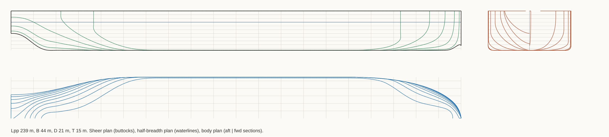
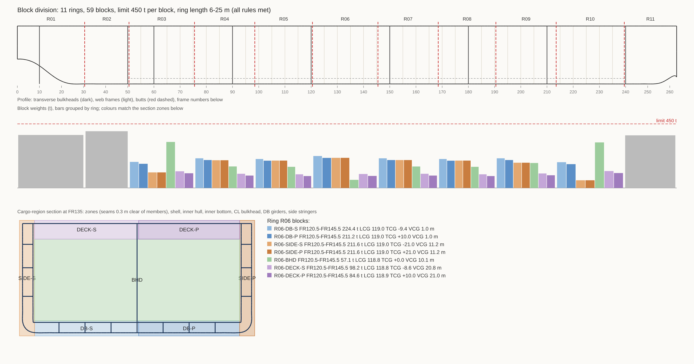

# hullcad: 조선 설계용 선형 CAD 코어 (1단계)

선형(hull form)을 B-spline 곡면으로 정의하고, 유체정역학과 복원성을 **멀티스레드 CPU**와
**GPGPU(CUDA)** 백엔드로 계산하는 C++20 코어입니다. 기준선은 **120k DWT 원유 탱커(Aframax/LR2급)**입니다.



## 현재 할 수 있는 것

| 모듈 | 내용 |
|---|---|
| `bspline` | B-spline 곡선·곡면 평가, 도함수, 곡률, 전역 보간, 단면 skinning (Piegl & Tiller 알고리즘) |
| `hull_param` | 120k 탱커 파라메트릭 선형 → 오프셋 테이블 → bicubic B-spline 곡면 |
| `mesh` | 곡면 → 닫힌(watertight) 삼각형 메쉬 (좌현, 대칭 우현, 갑판, 선미·선수 마감면) |
| `hydro_kernel` | 임의의 경사·트림 수선면에 대한 배수량, 부심, 수선면적, 관성모멘트 계산 (CPU와 CUDA가 같은 코드 사용) |
| `compute_backend` | 수선면 여러 개를 한 번에 계산하는 배치 인터페이스. CPU(자체 스레드풀)와 CUDA 구현 |
| `hydrostatics` | 정수압 곡선표(hydrostatic table), 고정 트림 GZ 곡선 (모든 경사각을 한 배치로 Newton 반복) |
| `lines_plan` | 메쉬 단면으로 선도 SVG 출력 (정면도·반폭도·측면도) |
| `structure` | 프레임 테이블과 참조 기반 탱커 구조 배치(횡격벽, 웹, 이중저·이중선체, 거더, 스트링거). 선형이 바뀌면 다시 생성됨 |
| `blocks` | 블록 분할: 존(seam), 존별 강재 중량 모델, 버트 자동 선정(DP), 수동 버트 규칙 검사, CSV·SVG 출력 |

### 데모 결과 (설계 흘수 15 m)

```
Lpp 239.0 m  B 44.0 m  D 21.0 m  T 15.0 m
Displacement 132419 t  (volume 129189 m3)
Cb 0.819  Cw 0.886  LCB 5.56 m fwd of midship  KB 7.81 m
Awp 9316 m2  LCF 1.45 m fwd of midship  TPC 95.5 t/cm  MCT 1583 t.m/cm
BMt 10.17 m  KMt 17.98 m  BMl 285.7 m
GZ curve (fixed trim, KG 13.0 m assumed, GM 4.98 m): GZmax 1.99 m at 30.0 deg

== Benchmark: 2250 waterplanes x 77602 triangles ==
cpu(1 threads)                  4.562 s  (493 planes/s)
cpu(4 threads)                  1.133 s  (1985 planes/s, speed-up x4.03)
```

## 블록 분할 (Block division)



1. **존(seam)**: 화물구역 단면을 7개 존(DB-P/S, SIDE-P/S, BHD, DECK-P/S)으로 나눕니다. seam은 부재에서
   300 mm 떨어지게 두어 어떤 부재도 seam 위에 걸치지 않게 합니다. 선수미부의 링은 블록 하나로 봅니다.
2. **중량 모델**: 선체를 0.25 m 두께의 x 슬라이스로 나눠 각 단면의 부재 길이 × 두께 × (1 + 보강재 계수)를
   존별로 병렬 계산하고 누적합으로 저장합니다. 그래서 어떤 x 구간의 블록 중량이든 O(1)로 구합니다.
   횡격벽과 웹(개구부 30 % 공제)은 점 부재로 따로 더합니다.
3. **버트 후보**: 프레임과 프레임 사이 중앙 중에서 횡격벽·웹과 300 mm 이상 떨어진 위치만 후보로 씁니다.
   기관실 전단 격벽 바로 앞과 충돌 격벽 바로 뒤의 버트는 필수입니다.
4. **자동 분할 (동적계획법)**: 모든 블록이 크레인 용량 이하이고 링 길이가 범위 안에 들도록 하면서
   ① 링 수를 최소로 하고, ② 링 중량 제곱합을 최소로 해서 링 크기를 고르게 맞춥니다. 전역 최적해를 구합니다.
5. **수동 검사**: `--butts`로 직접 정한 버트를 넣으면 블록 중량, 링 길이, 부재와의 이격, 구역 경계를
   넘는지를 검사해 위반 항목을 출력합니다.

```bash
./build/hullcad_demo --max-block 450 --ring-length 6 25          # 자동 분할 (기본값)
./build/hullcad_demo --max-block 300                              # 크레인 용량을 바꾸면 다시 분할
./build/hullcad_demo --butts 30.5,50.5,75.5,98.5,120.5,145.5      # 수동 버트(프레임 번호) 검사
```

데모 결과 (한계 450 t): 링 11개, 블록 59개. 화물구역 링은 링당 1,100~1,130 t으로 고르게 나뉘고,
가장 무거운 블록은 R02-AFT 398 t입니다. 한계를 300 t으로 낮추면 링 13개, 최대 블록 296 t이 됩니다.

**주의**: 판 두께와 보강재 계수는 블록 계획용 가정값이며 CSR 치수 계산이 아닙니다. 호퍼, 탱크 안 트랜스버스,
기관실·선미·선수 내부 구조, 상부구조, 의장품은 아직 모델에 없습니다. 그래서 강재 중량 합계(약 1.0만 t)는
실선의 선체 강재 중량(약 1.5~1.7만 t)보다 작습니다.

## 빌드

```bash
cmake -S . -B build -DCMAKE_BUILD_TYPE=Release
cmake --build build -j
./build/hullcad_tests             # 단위 테스트
./build/hullcad_demo --out out    # 오프셋, 정수압표, GZ, 선도, OBJ 메쉬 출력 + 벤치마크
```

CUDA 백엔드 (NVIDIA GPU와 CUDA Toolkit 12.x 필요):

```bash
cmake -S . -B build-cuda -DHULLCAD_ENABLE_CUDA=ON -DCMAKE_CUDA_ARCHITECTURES=86
cmake --build build-cuda -j
./build-cuda/hullcad_demo         # 벤치마크에 cuda 행과 CPU 대비 오차가 함께 출력됨
```

## 설계 원칙

- **계산 수식은 한 곳에만 둡니다.** 삼각형 하나의 적분은 `hydro_kernel.hpp` 하나에 있고, CPU와
  CUDA가 이 코드를 그대로 컴파일합니다. 백엔드끼리는 실행 방식만 다릅니다.
- **솔버는 백엔드를 모릅니다.** 정수압표와 GZ 솔버는 "수선면 배치 → 적분값 배치" 인터페이스만
  사용합니다. GZ도 경사각별로 따로 돌지 않고 모든 경사각의 Newton 반복을 한 배치로 진행하므로
  그대로 GPU에 맞는 구조입니다.
- **결정성(determinism)을 보장합니다.** CPU 백엔드는 삼각형을 고정 크기 청크로 더하고 청크 합을
  고정 순서로 더합니다. 그래서 스레드 수나 배치 크기가 달라도 결과가 비트 단위로 같습니다
  (테스트로 검증). 선급 제출용 계산서는 매번 같은 숫자가 나와야 하기 때문입니다.
  GPU는 리덕션 순서가 달라 상대오차로 비교합니다.
- **수선면 캡을 만들지 않습니다.** 사면체의 꼭짓점을 수선면 위에 두면 캡의 부피 기여가 0이 됩니다.
  수선면적과 관성모멘트는 클리핑에서 나오는 수선 선분에 그린 정리를 적용해 구합니다. 그래서
  경사·트림이 어떻든, 갑판이 잠기든 같은 코드로 처리합니다.

## 검증 (tests/test_main.cpp)

- 상자형 바지선의 해석해: 배수량, KB = T/2, BMt = B²/12T, BMl = L²/12T, LCF, Cb
- 경사·트림 수선면에서 배수량 보존
- Wall-sided 공식: GZ = sinφ (GM + ½ BM tan²φ), 0~20°에서 1e-7 m 이내로 일치
- B-spline: 보간점 통과, 원의 곡률 1/R, 도함수와 유한차분 비교
- 탱커 메쉬가 닫혀 있고 방향이 일관됨, 메쉬 세분화 시 배수량 변화 < 0.1 %
- 1스레드와 4스레드, 단일 계산과 배치 계산 결과의 비트 단위 일치
- 프레임 테이블 변환 왕복(x ↔ 프레임 번호)
- 상자형 선체의 블록 중량 해석해, 존 분할에 빈틈이나 중복이 없음, 1스레드와 4스레드 중량 모델의 비트 단위 일치
- 탱커 자동 분할: 모든 블록 ≤ 한계, 링 길이 범위, 버트 이격, 블록 합계 = 전체 중량, 화물구역 링 수가 최소인지,
  잘못된 수동 버트와 불가능한 한계를 검출하는지

## 한계 (현재 형상은 실선이 아니라 데모용 파라메트릭 선형)

- 구상선수(bulbous bow), 선미 스케그·보스, 수면 위 플레어는 아직 모델링하지 않았습니다.
- GZ는 **고정 트림**으로 계산합니다(자유 트림은 다음 단계). KG 13.0 m는 가정값입니다.
- 상부구조, 해치, 개구부 침수각은 반영하지 않았습니다. 갑판은 수밀로 가정합니다.
- CUDA 백엔드는 nvcc 12.6(sm_86)에서 컴파일·링크까지 확인했습니다. **실제 GPU에서는 아직 실행해 보지
  않았으므로**, GPU 장비에서 데모를 실행해 CPU 대비 오차가 출력되는지 꼭 확인하세요.
- 소비자용 GeForce는 FP64(배정밀도) 성능이 FP32의 1/32~1/64 수준입니다. 대량 배치는 FP64 성능이 높은
  카드(A100/H100, 일부 워크스테이션 카드)가 유리합니다.

## 다음 단계

1. OCCT 8.0 연동: 블록을 B-rep 솔리드로 만들고 STEP으로 출력, 판재·보강재 실형상과 불리언 연산
2. 페어링: 곡률 콤 표시, 에너지 최소화로 control point 자동 순정
3. 자유 트림 GZ, 탱크·구획 정의, 적하 조건(loading condition)
4. MARPOL Annex I 손상 복원성(Reg. 28)과 유출유 성능(Reg. 23): 손상 조합이 수천 건이라 GPU 배치에 적합
5. 구상선수와 선미 형상, 다중 패치 위상
6. Python 바인딩(nanobind)과 Qt GUI, STEP/IGES 출력(OpenCASCADE)
