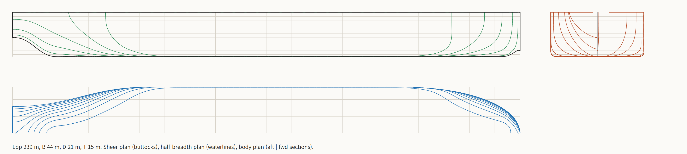

# hullcad: 조선 설계용 선형 CAD 코어 (1단계)

선형(hull form)을 B-spline 곡면으로 정의하고, 유체정역학과 복원성을 **멀티스레드 CPU**와
**GPGPU(CUDA)** 백엔드로 계산하는 C++20 코어입니다. 기준선은 **120k DWT 원유 탱커(Aframax/LR2급)**입니다.



## 현재 할 수 있는 것

| 모듈 | 내용 |
|---|---|
| `bspline` | B-spline 곡선·곡면 평가, 도함수, 곡률, 전역 보간, 단면 skinning (Piegl & Tiller 알고리즘) |
| `hull_param` | 120k 탱커 파라메트릭 선형 → 오프셋 테이블 → bicubic B-spline 곡면 |
| `mesh` | 곡면 → 닫힌(watertight) 삼각형 메쉬 (좌현, 대칭 우현, 갑판, 선미·선수 마감면) |
| `hydro_kernel` | 임의의 경사·트림 수선면에 대한 배수량, 부심, 수선면적, 관성모멘트 계산 (CPU와 CUDA가 같은 코드 사용) |
| `compute_backend` | 수선면 여러 개를 한 번에 계산하는 배치 인터페이스. CPU(자체 스레드풀)와 CUDA 구현 |
| `hydrostatics` | 정수압 곡선표(hydrostatic table), 고정 트림 GZ 곡선 (모든 경사각을 한 배치로 Newton 반복) |
| `lines_plan` | 메쉬 단면으로 선도 SVG 출력 (정면도·반폭도·측면도) |
| `structure` | 프레임 테이블과 참조 기반 탱커 구조 배치(횡격벽, 웹, 이중저·이중선체, 거더, 스트링거). 선형이 바뀌면 다시 생성됨 |
| `yard` | 야드 프로파일: 공정별 설비 한계(절단, 판넬라인, 곡블록, 중조립, 대조립, 반전, 도장, 트랜스포터, 탑재)를 INI로 입력 |
| `blocks` | 블록 분할: 존(seam), 존별 중량·형상 모델, 야드 검사, 버트 자동 선정(DP), 불가능 원인 진단, 병목 리포트, CSV·SVG 출력 |

### 데모 결과 (설계 흘수 15 m)

```
Lpp 239.0 m  B 44.0 m  D 21.0 m  T 15.0 m
Displacement 132421 t  (volume 129191 m3)
Cb 0.819  Cw 0.886  LCB 5.56 m fwd of midship  KB 7.81 m
Awp 9316 m2  LCF 1.45 m fwd of midship  TPC 95.5 t/cm  MCT 1583 t.m/cm
BMt 10.17 m  KMt 17.98 m  BMl 285.7 m
GZ curve (fixed trim, KG 13.0 m assumed, GM 4.98 m): GZmax 1.99 m at 30.0 deg

== Benchmark: 2250 waterplanes x 77602 triangles ==
cpu(1 threads)                  4.562 s  (493 planes/s)
cpu(4 threads)                  1.133 s  (1985 planes/s, speed-up x4.03)
```

## 블록 분할 (Block division)


블록 분할은 **야드 프로파일(INI 파일)**을 따릅니다. 같은 엔진으로 야드마다 다른 설비 조건을 반영할 수 있어요.
`yards/large_yard.ini`(대형 야드 예시, 모든 키와 설명 포함)와 `yards/mid_yard.ini`(중형 야드 예시)가 있습니다.
수치는 모두 **예시값**입니다. 실제 야드 값으로 바꿔 쓰세요.

### 1. 블록이 거치는 생산 공정과 검사 항목

블록은 아래 공정을 순서대로 거치고, 켜져 있는(`enabled = true`) 공정마다 모든 검사를 통과해야 합니다.

| 공정 (INI 섹션) | 검사 | 블록 분할에 주는 영향 |
|---|---|---|
| `[weight]` 중량 여유 | 강재 여유, 선행의장 비율, 리깅 중량 | 모든 중량 검사에 쓰이는 운반 중량·인양 중량 산출 |
| `[division]` 분할 형상 | 링 길이, 버트·심 이격, 데크 블록 높이, 사이드 상·하 분할, **추가 종방향 심** | 존(블록 단면) 구성 자체를 정함 |
| `[cutting]` 절단/강재 | 블록 안 론지 버트 금지(블록 길이 ≤ 보강재 길이), 강판 규격 | 링 길이 상한. 판 버트·심 수는 참고값으로 CSV에 출력 |
| `[panel_line]` 판넬라인 | 평블록 주판넬 크기, 격벽 판넬 크기·중량 | 평블록의 길이·폭 |
| `[curved_shop]` 곡블록 공장 | 곡블록 L×B×H, (선택) 크레인 | 곡블록 크기 |
| `[medium_assembly]` 중조립 | 웹·플로어 서브유닛 크기와 크레인 | 존 폭·높이 (웹 크기) |
| `[assembly]` 대조립 | 크레인(단독/텐덤), 정반·베이 L×B×H, 출입문 W×H | 블록 중량·크기 |
| `[turnover]` 반전 | 뒤집어 제작하는 블록(DB, 데크)의 반전 능력 | DB·데크 블록 중량 |
| `[painting]` 도장 | 셀 L×B×H, 셀 최대 중량 | 블록 크기·중량 |
| `[transporter]` 트랜스포터 | 대당 능력 × 동시 투입 대수 × 효율, 적재 높이(블록 H + 데크), 경로 폭 | 블록 중량·높이 |
| `[erection]` 탑재 | 도크/골리앗 크레인 (텐덤) | 블록 인양 중량 |

평블록과 곡블록은 형상에서 자동으로 판정합니다. 외판이 1 cm 이내로 평면이면 평블록이고 판넬라인을 거칩니다.
그렇지 않으면 곡블록이고 곡블록 공장을 거칩니다.

**블록 분할에 직접 들어가지 않는 항목**은 부재나 일정 단위의 문제라서 이번 범위에서 뺐습니다.
- 소조립(브래킷, 칼라 등 소부재)
- 절단기 테이블 크기와 절단 방식(부재 네스팅)
- 도장 셀 수와 공장 처리량(일정 계획)
- 선행탑재(PE)의 그랜드 블록 조합

### 2. 동작 방식

1. **존(seam)**: 화물구역 단면을 DB, SIDE, BHD, DECK × 좌·우 존으로 나눕니다.
   - `long_seams_y`로 폭 방향을, `side_split_z`로 사이드 높이 방향을 더 나눌 수 있습니다.
   - 선수미부는 LOW/UP × 좌·우 존을 씁니다.
   - 존은 반열린 구간 [min, max)라서 심이 부재와 겹쳐도 중량이 두 번 계산되지 않습니다.
2. **중량·형상 모델**: 0.25 m 슬라이스마다 존별 중량, 외곽 치수, 평면도를 병렬로 계산합니다. 블록 중량은 누적합으로 O(1)에 구합니다.
3. **버트 후보**: 프레임 사이 중앙 중에서 횡격벽·웹과 이격을 지키는 위치만 씁니다.
4. **자동 분할 (동적계획법)**: 모든 블록이 모든 검사를 통과하는 범위에서
   ① 링 수를 최소로 하고, ② 링 중량 제곱합을 최소로 해서 링 크기를 고르게 맞춥니다.
5. **불가능하면 원인을 진단**합니다. 가장 짧은 링으로도 통과하지 못하는 검사를 이름과 수치로 알려 줍니다. 예:
   `medium_assembly.size fails even for 6.0 m rings ... web unit 8.2 x 15.7 m vs 22.0 x 6.0 m`
6. **병목 리포트**: 검사마다 최대 이용률과 몇 개 블록에서 지배적인지를 출력합니다.
7. **What-if 스윕**: 설비 값 하나를 바꿔 가며 링 수와 블록 수가 어떻게 바뀌는지 봅니다.

```bash
./build/hullcad_demo --yard yards/mid_yard.ini                                 # 야드 프로파일 적용
./build/hullcad_demo --set transporter.units=3 --set painting.enabled=false   # 개별 값 덮어쓰기
./build/hullcad_demo --sweep transporter.unit_capacity=60,80,100,150,300      # what-if
./build/hullcad_demo --butts 30.5,50.5,75.5,98.5,120.5                         # 수동 버트(프레임 번호) 검사
./build/hullcad_demo --write-yard my_yard.ini                                  # 설명이 달린 전체 템플릿 생성
```

### 3. 데모 결과

| 야드 | 링 | 블록 (평/곡) | 최대 인양 중량 | 주된 병목 |
|---|---|---|---|---|
| 대형 (`large_yard.ini`) | 11 | 75 (33/42) | 246 t | 론지 길이 25 m (45개 블록), 도장 셀 높이 (사이드 블록) |
| 중형 (`mid_yard.ini`) | 17 | 217 (119/98) | 95 t | 론지 길이 16 m (191개 블록) |

What-if 결과 예시:
- 중형 야드에서 론지 길이를 16 m에서 18 m로 늘리면 링이 17개에서 16개로 줄어듭니다. 20 m 이상부터는 판넬라인이 새 병목이 됩니다.
- 대형 야드는 트랜스포터 대당 150 t까지 링 11개를 유지합니다. 100 t이면 13개, 60 t이면 23개로 늘어납니다.


**주의**: 판 두께와 보강재 계수는 블록 계획용 가정값이며 CSR 치수 계산이 아닙니다. 호퍼, 탱크 안 트랜스버스,
기관실·선미·선수 내부 구조, 상부구조, 의장품은 아직 모델에 없습니다(선행의장은 비율로만 반영). 그래서 강재 중량
합계(약 1.0만 t)는 실선의 선체 강재 중량(약 1.5~1.7만 t)보다 작습니다.

## 빌드

```bash
cmake -S . -B build -DCMAKE_BUILD_TYPE=Release
cmake --build build -j
./build/hullcad_tests             # 단위 테스트
./build/hullcad_demo --out out    # 오프셋, 정수압표, GZ, 선도, OBJ 메쉬 출력 + 벤치마크
```

CUDA 백엔드 (NVIDIA GPU와 CUDA Toolkit 12.x 필요):

```bash
cmake -S . -B build-cuda -DHULLCAD_ENABLE_CUDA=ON -DCMAKE_CUDA_ARCHITECTURES=86
cmake --build build-cuda -j
./build-cuda/hullcad_demo         # 벤치마크에 cuda 행과 CPU 대비 오차가 함께 출력됨
```

## 설계 원칙

- **계산 수식은 한 곳에만 둡니다.** 삼각형 하나의 적분은 `hydro_kernel.hpp` 하나에 있고, CPU와
  CUDA가 이 코드를 그대로 컴파일합니다. 백엔드끼리는 실행 방식만 다릅니다.
- **솔버는 백엔드를 모릅니다.** 정수압표와 GZ 솔버는 "수선면 배치 → 적분값 배치" 인터페이스만
  사용합니다. GZ도 경사각별로 따로 돌지 않고 모든 경사각의 Newton 반복을 한 배치로 진행하므로
  그대로 GPU에 맞는 구조입니다.
- **결정성(determinism)을 보장합니다.** CPU 백엔드는 삼각형을 고정 크기 청크로 더하고 청크 합을
  고정 순서로 더합니다. 그래서 스레드 수나 배치 크기가 달라도 결과가 비트 단위로 같습니다
  (테스트로 검증). 선급 제출용 계산서는 매번 같은 숫자가 나와야 하기 때문입니다.
  GPU는 리덕션 순서가 달라 상대오차로 비교합니다.
- **수선면 캡을 만들지 않습니다.** 사면체의 꼭짓점을 수선면 위에 두면 캡의 부피 기여가 0이 됩니다.
  수선면적과 관성모멘트는 클리핑에서 나오는 수선 선분에 그린 정리를 적용해 구합니다. 그래서
  경사·트림이 어떻든, 갑판이 잠기든 같은 코드로 처리합니다.

## 검증 (tests/test_main.cpp)

- 상자형 바지선의 해석해: 배수량, KB = T/2, BMt = B²/12T, BMl = L²/12T, LCF, Cb
- 경사·트림 수선면에서 배수량 보존
- Wall-sided 공식: GZ = sinφ (GM + ½ BM tan²φ), 0~20°에서 1e-7 m 이내로 일치
- B-spline: 보간점 통과, 원의 곡률 1/R, 도함수와 유한차분 비교
- 탱커 메쉬가 닫혀 있고 방향이 일관됨, 메쉬 세분화 시 배수량 변화 < 0.1 %
- 1스레드와 4스레드, 단일 계산과 배치 계산 결과의 비트 단위 일치
- 프레임 테이블 변환 왕복(x ↔ 프레임 번호)
- 상자형 선체의 블록 중량 해석해, 존 분할에 빈틈이나 중복이 없음, 1스레드와 4스레드 중량 모델의 비트 단위 일치
- 존이 반열린 구간이라 심과 부재가 겹쳐도 중복 계산이 없음, 추가 심을 넣어도 분할이 정확함
- 야드 프로파일: 값 설정, 잘못된 키·값 거부, 모든 키의 쓰기→읽기 왕복
- 탱커 자동 분할: 모든 블록이 모든 검사를 통과, 링 길이 범위, 버트 이격, 블록 합계 = 전체 중량,
  화물구역 링 수가 하한과 같은지, 중앙부 DB 블록이 평블록인지, 트랜스포터를 줄이면 링이 늘어나는지,
  꺼진 공정은 검사하지 않는지, 거더 위의 심과 웹 위의 버트를 검출하는지, 불가능한 야드에서 원인 검사 이름이 나오는지

## 한계 (현재 형상은 실선이 아니라 데모용 파라메트릭 선형)

- 구상선수(bulbous bow), 선미 스케그·보스, 수면 위 플레어는 아직 모델링하지 않았습니다.
- 단면 점을 B-spline으로 전역 보간하기 때문에, 평저부·평측부에 미세한 굴곡이 남습니다(단면당 49점에서 약 1~2 mm,
  25점이면 약 1 cm). 평저선·평측선을 패치 경계로 두는 다중 패치와 페어링 단계에서 근본적으로 해결할 예정입니다.
- GZ는 **고정 트림**으로 계산합니다(자유 트림은 다음 단계). KG 13.0 m는 가정값입니다.
- 상부구조, 해치, 개구부 침수각은 반영하지 않았습니다. 갑판은 수밀로 가정합니다.
- CUDA 백엔드는 nvcc 12.6(sm_86)에서 컴파일·링크까지 확인했습니다. **실제 GPU에서는 아직 실행해 보지
  않았으므로**, GPU 장비에서 데모를 실행해 CPU 대비 오차가 출력되는지 꼭 확인하세요.
- 소비자용 GeForce는 FP64(배정밀도) 성능이 FP32의 1/32~1/64 수준입니다. 대량 배치는 FP64 성능이 높은
  카드(A100/H100, 일부 워크스테이션 카드)가 유리합니다.

## 다음 단계

1. OCCT 8.0 연동: 블록을 B-rep 솔리드로 만들고 STEP으로 출력, 판재·보강재 실형상과 불리언 연산
2. 페어링: 곡률 콤 표시, 에너지 최소화로 control point 자동 순정
3. 자유 트림 GZ, 탱크·구획 정의, 적하 조건(loading condition)
4. MARPOL Annex I 손상 복원성(Reg. 28)과 유출유 성능(Reg. 23): 손상 조합이 수천 건이라 GPU 배치에 적합
5. 구상선수와 선미 형상, 다중 패치 위상
6. Python 바인딩(nanobind)과 Qt GUI, STEP/IGES 출력(OpenCASCADE)
